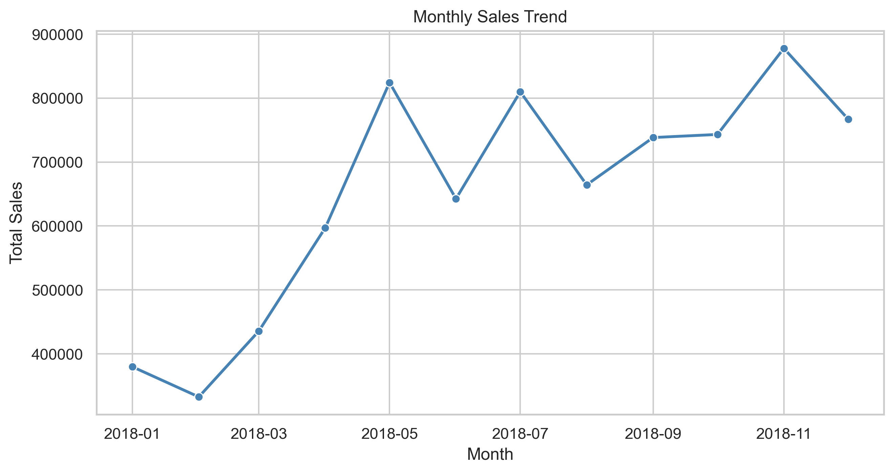
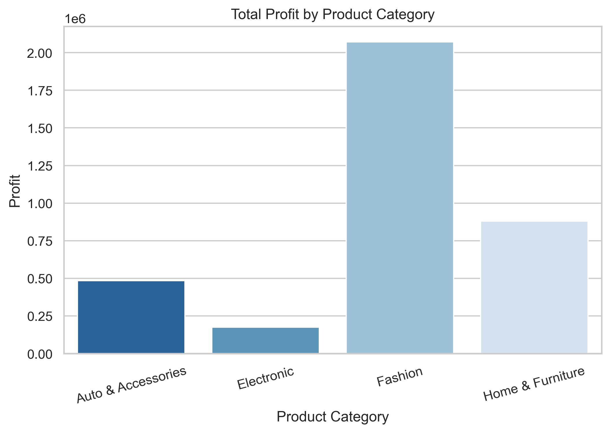
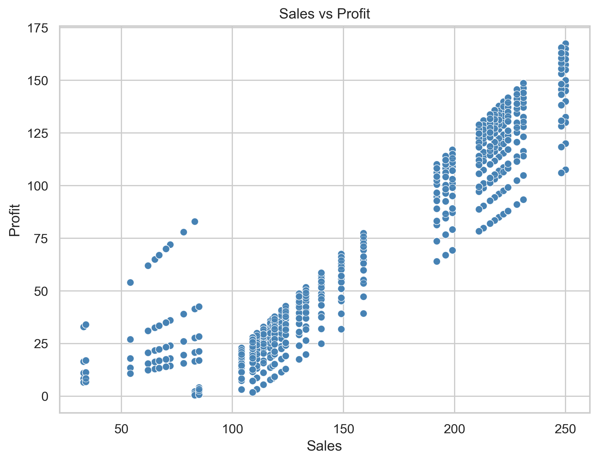
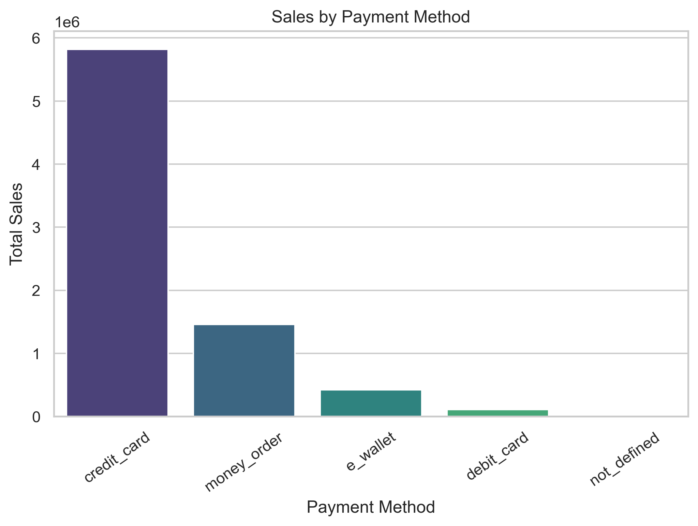
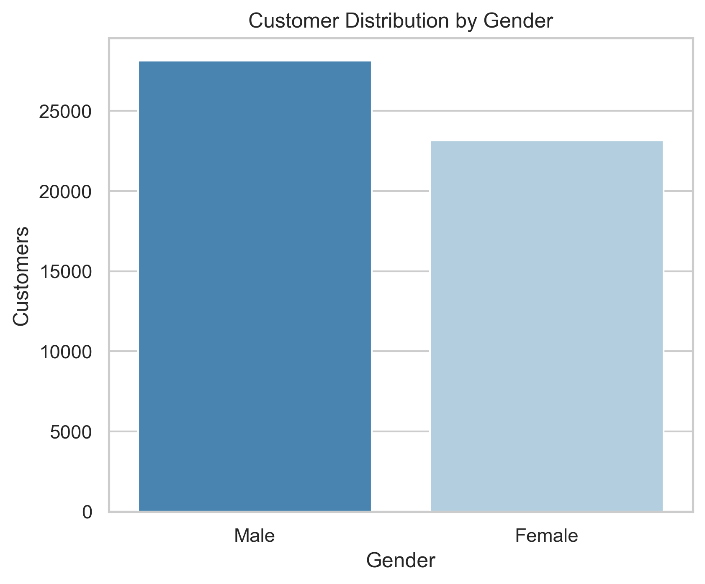

# 📊 Retail Sales Performance Analysis

## Project – Data Analytics Portfolio


---

## 📌 Project Overview

This project presents an end-to-end **Exploratory Data Analysis (EDA)** of a retail sales dataset using Python.

The objective was to transform transactional retail data into meaningful business insights by analyzing sales performance, profitability, customer behavior, purchasing patterns, and commercial trends.

The project follows a complete data analytics workflow, combining:

- Data exploration
- Data cleaning
- Feature engineering
- Exploratory analysis
- Data visualization
- Statistical analysis
- Business interpretation
- Actionable recommendations

Rather than focusing only on technical analysis, the project is structured around **business questions and decision-making**.

---

## 🎯 Business Questions

The analysis was designed to answer questions such as:

- How does sales performance evolve throughout the year?
- Which product categories generate the highest profit?
- Which categories achieve the strongest profit margins?
- How strongly are sales and profit related?
- Which products generate the most revenue?
- Which payment methods are preferred by customers?
- Do customers purchase more frequently through web or mobile?
- What types of customers account for most transactions?
- How are orders distributed by priority?
- Are there relevant demographic purchasing patterns?

---

## 🛠 Technologies & Skills

- Python
- Pandas
- NumPy
- Matplotlib
- Seaborn
- Jupyter Notebook
- Data Cleaning
- Feature Engineering
- Exploratory Data Analysis
- Statistical Analysis
- Data Visualization
- Business Analysis
- Analytical Storytelling
- Git
- GitHub

---

## 🔄 Analytics Workflow

The project follows a structured analytical workflow:

### 1. Data Exploration

The dataset was inspected to understand:

- Available variables
- Data types
- Dataset dimensions
- Missing values
- Numerical distributions
- Categorical variables

### 2. Data Cleaning

The dataset was prepared for analysis through data-quality checks and transformations required by the analytical workflow.

### 3. Feature Engineering

Additional analytical variables were created where necessary to support profitability, customer, and time-based analysis.

### 4. Exploratory Data Analysis

The prepared dataset was analyzed from multiple business perspectives including:

- Sales
- Profit
- Product categories
- Products
- Customers
- Payment methods
- Devices
- Order priority
- Demographics

### 5. Data Visualization

Visualizations were created using **Matplotlib and Seaborn** to identify trends, relationships, rankings, and customer patterns.

### 6. Business Interpretation

Each major analysis was interpreted from a business perspective to translate analytical results into meaningful findings.

---

## 📈 Exploratory Analysis

The notebook includes the following analyses:

- Monthly Sales Trend
- Profit by Product Category
- Profit Margin Analysis
- Sales vs Profit Relationship
- Correlation Matrix
- Top 10 Products by Sales
- Sales by Device Type
- Sales by Payment Method
- Orders by Priority
- Customer Login Type
- Customer Distribution by Gender

Each analytical section combines:

**Data Preparation → Visualization → Business Insight**

---

## 📊 Sample Visualizations

<p align="center">
  
  
</p>

<p align="center">
  
  
</p>

<p align="center">
  
</p>

---

## 💡 Key Business Insights

The analysis reveals several relevant business patterns:

- **Sales show an overall upward trend throughout the year**, indicating stronger commercial performance toward later periods.

- **Fashion is the strongest-performing category from a profitability perspective**, generating both the highest total profit and the highest profit margin.

- **Sales and Profit show a very strong positive correlation of 0.92**, indicating that higher sales volumes are strongly associated with higher profitability in the dataset.

- **Credit cards are the dominant payment method**, representing the preferred payment option among customers.

- **Most customers are registered members**, indicating a strong presence of identified and recurring customers within the dataset.

- **Web purchases exceed mobile purchases**, suggesting that the web channel plays a particularly important role in digital sales.

- **Customer distribution is relatively balanced between male and female shoppers**, with no major gender concentration.

- **Medium-priority orders represent the largest share of transactions**, making them the dominant order-priority category.

These findings demonstrate the value of analyzing **sales, profitability, customer behavior, and purchasing channels together rather than evaluating revenue in isolation**.

---

## 📁 Project Structure

```text
Retail-Sales-Data-Analysis/
│
├── data/
│
├── images/
│   ├── monthly_sales.png
│   ├── profit_by_category.png
│   ├── sales_vs_profit.png
│   ├── payment_method.png
│   └── customer_gender.png
│
├── notebooks/
│   └── 01_data_exploration.ipynb
│
├── README.md
├── requirements.txt
└── .gitignore
```

---

## ▶️ How to Run

Clone the repository:

```bash
git clone https://github.com/anjalisingh202021-cloud/Retail-Sales-Data-Analysis.git
```

Navigate to the project directory:

```bash
cd Retail-Sales-Data-Analysis
```

Install the required libraries:

```bash
pip install -r requirements.txt
```

Launch Jupyter Notebook:

```bash
jupyter notebook
```

Open:

```text
notebooks/01_data_exploration.ipynb
```

---

## 🚀 Project Outcome

This project demonstrates the development of a complete exploratory data analysis workflow, from raw data inspection and preparation to visualization, interpretation, and business-oriented conclusions.

The project demonstrates practical skills in:

- Python data analysis
- Data manipulation with Pandas
- Numerical analysis with NumPy
- Data cleaning
- Feature engineering
- Exploratory Data Analysis
- Statistical analysis
- Data visualization
- Correlation analysis
- Customer behavior analysis
- Product performance analysis
- Business insight generation
- Analytical storytelling

As **Project 01** of the portfolio, it establishes the foundation for the more advanced SQL, Machine Learning, and Business Intelligence projects developed later in the portfolio.

---

## 👨‍💻 By Anjali Singh

Analytical thinker combining data analytics, scientific computing, and geoscience experience, with a focus on Python, SQL, data visualization, and business-oriented problem solving.
